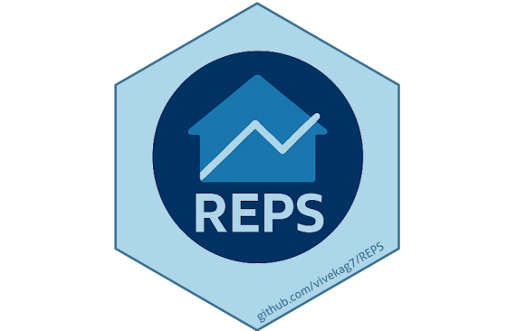

# REPS: Hedonic and Multilateral Index Methods for Real Estate Price Statistics 

<!-- badges: start -->
[](https://github.com/vivekag7/REPS/actions/workflows/R-CMD-check.yaml)
<!-- badges: end -->

**REPS** (Real Estate Price Statistics) is an R package for computing price indices using a variety of hedonic regression and multilateral methods. It provides a unified interface to calculate quality-adjusted price indices across time, supporting classical index formulas as well as advanced techniques tailored to property price analysis. While developed with real estate in mind, the package is applicable to any domain where reliable, quality-adjusted price comparisons over time are needed. REPS was developed by Statistics Netherlands (CBS) with funding from Eurostat, aligning with international guidelines for compiling residential property price indices.

## Installation

You can install the development version of **REPS** from GitHub using **devtools**:

```r
# install.packages("devtools")  # if devtools is not installed
devtools::install_github("vivekag7/REPS")
```

## Hedonic Price Index Methods

REPS offers a **single entry point** `calculate_hedonic_index()` to compute price indices using different methodologies. By changing the `method` argument, you can generate indices with any of the supported approaches, all from the same dataset and function call. Supported index calculation methods include:

- **Laspeyres** - Base-period weighted hedonic double imputation index.
- **Paasche** - Current-period weighted hedonic double imputation index.
- **Fisher** - The geometric mean of Laspeyres and Paasche indices.
- **Time Dummy** - A single regression with time dummy variables (log-linear hedonic model).
- **Rolling Time Dummy** - A rolling window (chained) time-dummy hedonic index.
- **Repricing** - A quasi-repeat-sales method comparing observed vs. predicted price changes between consecutive periods.
- **HMTS** - *Hedonic Multilateral Time Series re-estimation with Splicing*. An advanced multilateral index method that leverages hedonic models across all period pairs and uses Kalman filtering to improve stability.
- **Median** - An **unadjusted median-price baseline** for comparison with hedonic methods. It uses untransformed prices and does not adjust for quality or changes in the mix of properties sold.

All methods are accessed via `calculate_hedonic_index()` with a consistent interface. The function returns either a single index or, for multiple methods, a list of results. A reference period can be specified to normalize index values (default sets the first period to 100).

The median baseline requires only price and period columns:

```r
median_index <- calculate_hedonic_index(
  dataset = hedonic_data,
  method = "median",
  period_variable = "period",
  dependent_variable = "price"
)
```

It calculates the median price per period and divides it by the reference median,
multiplied by 100. Missing prices or periods are excluded; unused explanatory
columns do not affect the sample. `reference_period` also accepts a prefix such
as `"2015"`, using the mean of the matching period medians. Observation counts
are included by default and can be disabled with `number_of_observations = FALSE`.
The existing annual-overlap calculation is available through `chained = TRUE`.
For `method = c("median", "fisher")`, supply explanatory variables for Fisher;
median still uses only price and period.

## Diagnostics and Visualization Tools

- **Regression Diagnostics:** `calculate_regression_diagnostics()` fits a separate log-linear model per period and checks normality, R^2, autocorrelation, and heteroscedasticity of residuals. `plot_regression_diagnostics()` visualizes these over time in a 3x2 grid.
- **Index Visualization:** `plot_price_index()` plots one or more index series as a time-series chart for comparison and exploration.

## Getting Started and Documentation

- **Example Dataset:** `hedonic_data` is included (7,800 x 6), simulating real estate transactions. Use `data("hedonic_data")` to load it.
- **Vignettes:** Use `vignette("calculate_hedonic_index", package="REPS")` and `vignette("calculate_regression_diagnostics", package="REPS")` for step-by-step guides using the example dataset.

REPS provides a comprehensive and extensible framework to compute and evaluate real estate price indices. Its flexible architecture enables comparison across methods and statistical validation of underlying models, suitable for both official statistics and research applications.

